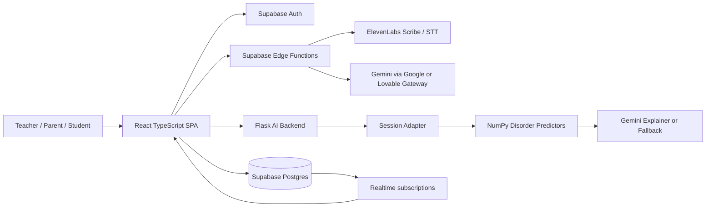

# SwarSetu Technical Audit Report

PDF-ready Markdown version. Generated from the local repository at `D:\OneDrive\Desktop\swar-setu-main` on 2026-08-10. This report is based only on files present in this repository.

## Source Control Note

The working tree was already dirty before this report was created. Modified files included `.gitignore`, multiple files under `src/`, `frontend/src/`, `supabase/`, and `package-lock.json`. This report does not change application code.

## Evidence Boundaries

| Category | Verified facts | Main source files |
|---|---|---|
| Runtime frontend | React 18, TypeScript, Vite single page app using routes in `src/App.tsx`. There is also a near-duplicate `frontend/` tree used by the Dockerfile build stage. | `package.json`, `src/App.tsx`, `frontend/package.json`, `Dockerfile` |
| Runtime backend | Flask app registers health, assessment, explainability, training, and report blueprints, and exposes a duplicate direct `/api/assess` route. | `backend/app.py`, `backend/routes/*.py` |
| ML backend | Flask production predictor uses three deterministic NumPy model classes, each extracting 20 features and running a seeded three-layer forward pass. | `backend/ml_models/*.py`, `backend/ai/session_adapter.py` |
| Research script | Root `unified_predictor.py` is a standalone PyTorch training and inference script using synthetic data, residual blocks, attention, asymmetric loss, threshold optimization, MC dropout, and plots. It is copied into Docker but not imported by Flask routes. | `unified_predictor.py`, `Dockerfile` |
| Database | Supabase/Postgres migrations define profiles, students, sessions, voice analysis, assessments, model metadata, predictions, reports, feedback, resources, badges, schools, and voice practice sessions with RLS policies. | `supabase/migrations/*.sql` |
| Edge functions | Supabase functions provide parent email verification, ElevenLabs transcription/tokening, voice analysis, voice practice analysis, Gemini/Lovable perception analysis, image generation, and Saathi chat. | `supabase/functions/*/index.ts` |

---

## 1. Executive Summary

SwarSetu is a multilingual AI learning support platform for early screening and support of specific learning disorder indicators: dyslexia, dyscalculia, and dysgraphia. The product connects teachers, parents, and students through assessment flows, dashboards, reports, voice practice, resources, badges, and an AI companion named Saathi. This is implemented by a React/Supabase frontend, Supabase Edge Functions, and a Flask AI backend. (`README.md`, `src/App.tsx`, `backend/app.py`, `supabase/functions/saathi-chat/index.ts`)

The practical problem solved is workflow orchestration around screening: a teacher adds students, runs tests, persists reports, and parents view simplified summaries and resources. The application emphasizes screening and support; several UI strings and AI prompts correctly state that outputs are not diagnoses. (`src/pages/dashboard/TeacherDashboard.tsx`, `src/pages/dashboard/ParentDashboard.tsx`, `src/components/tests/DSM5DyslexiaTest.tsx`, `supabase/functions/analyze-voice/index.ts`)

Target users are teachers, parents, principals, and students. Routes exist for parent, teacher, and principal dashboards, protected with Supabase auth. (`src/App.tsx`, `src/contexts/AuthContext.tsx`, `src/components/ProtectedRoute.tsx`)

The main technical moat is breadth of modality: structured DSM-5-styled question flows, handwriting stroke analytics, speech transcription and LLM analysis, perception/image tasks, role-based dashboards, Supabase RLS, and deterministic local ML scoring wrappers. The current implementation moat is stronger as a product integration and data workflow than as a validated clinical ML system. (`src/components/tests/*.tsx`, `src/lib/dysgraphiaAnalysis.ts`, `backend/ml_models/*.py`, `supabase/migrations/20260810000000_recreate_new_supabase_project.sql`)

---

## 2. System Architecture

### Component Architecture

| Layer | Implementation | Responsibilities | Sources |
|---|---|---|---|
| Frontend SPA | React + TypeScript + Vite | Routing, auth state, dashboards, tests, reports, learning resources, chatbot UI | `src/App.tsx`, `src/main.tsx`, `package.json` |
| UI toolkit | shadcn/Radix primitives, Tailwind, lucide icons, sonner/toasts | Cards, dialogs, tables, progress bars, tabs, navigation, icons | `src/components/ui/*`, `tailwind.config.ts`, `components.json` |
| Auth | Supabase Auth | Sign up, sign in, persistent sessions, protected dashboard routes | `src/contexts/AuthContext.tsx`, `src/components/ProtectedRoute.tsx` |
| Database | Supabase Postgres | Students, sessions, analysis, badges, resources, reports, roles, schools | `supabase/migrations/20260810000000_recreate_new_supabase_project.sql` |
| Edge Functions | Deno functions | Parent verification, STT, voice analysis, chat, perception/image services | `supabase/functions/*/index.ts` |
| Flask backend | Flask + CORS + blueprints | AI prediction, explainability, model info, training/report status endpoints | `backend/app.py`, `backend/routes/*.py` |
| ML wrappers | NumPy classes | Disorder-specific feature extraction and deterministic risk scoring | `backend/ml_models/dyslexia_nn_model.py`, `backend/ml_models/dyscalculia_nn_model.py`, `backend/ml_models/dysgraphia_nn_model.py` |
| Research ML script | PyTorch standalone script | Synthetic data, residual transformer classifier, training/evaluation, MC dropout | `unified_predictor.py` |
| Deployment | Docker multi-stage image | Builds `frontend/`, serves it through Flask static folder, runs Gunicorn | `Dockerfile`, `backend/gunicorn.conf.py` |

### ASCII Architecture Diagram

```text
Browser SPA
  |
  | React routes, Supabase client, fetch
  v
+-----------------------------+
| src/ React application      |
| - dashboards                |
| - assessment components     |
| - Saathi chatbot            |
+--------------+--------------+
               |
       +-------+----------------------------+
       |                                    |
       v                                    v
+----------------------+          +--------------------------+
| Supabase Auth        |          | Flask AI Backend          |
| Supabase Postgres    |          | backend/app.py            |
| Realtime             |          | /api/assess, /predict     |
+----------+-----------+          +------------+-------------+
           |                                   |
           v                                   v
+----------------------+          +--------------------------+
| Edge Functions       |          | ML + Explainability       |
| ElevenLabs STT       |          | session_adapter.py        |
| Gemini/Lovable AI    |          | ml_models/*.py            |
| Parent verification  |          | gemini_explainer.py       |
+----------------------+          +--------------------------+
```

### Mermaid Architecture Diagram



### Data Flow

1. A teacher logs in through Supabase Auth and enters the teacher dashboard. (`src/contexts/AuthContext.tsx`, `src/pages/dashboard/TeacherDashboard.tsx`)
2. The teacher adds or updates students via `useStudents`, which writes to Supabase and keeps a localStorage fallback cache. (`src/hooks/useStudents.ts`)
3. The teacher starts dyslexia, dyscalculia, dysgraphia, or perception tests from `TeacherDashboard`. (`src/pages/dashboard/TeacherDashboard.tsx`)
4. Structured tests compute browser-side summaries and risk labels, then `TeacherDashboard.handleTestComplete` persists non-perception sessions into `test_sessions`. (`src/components/tests/DSM5DyslexiaTest.tsx`, `src/components/tests/DSM5DyscalculiaTest.tsx`, `src/components/tests/DysgraphiaCanvas.tsx`, `src/pages/dashboard/TeacherDashboard.tsx`)
5. The same browser-side tests call Flask `/api/assess` asynchronously through `getAIPrediction`, but the returned prediction is logged and not currently persisted or merged into the saved session. (`src/api/ai.ts`, `src/components/tests/DSM5DyslexiaTest.tsx`, `src/components/tests/DSM5DyscalculiaTest.tsx`, `src/components/tests/DysgraphiaCanvas.tsx`)
6. Parents query linked students by `parent_id` or `parent_email`, view sessions, receive simplified summaries, use resources, and open Saathi. (`src/pages/dashboard/ParentDashboard.tsx`)

### Storage

Primary storage is Supabase Postgres. Local fallback storage exists for students and sessions under keys such as `swar_setu_local_students_v1` and `swar_setu_local_sessions_v1`. (`src/hooks/useStudents.ts`, `src/pages/dashboard/ParentDashboard.tsx`)

### Environment Variables

| Variable | Used by | Purpose | Sources |
|---|---|---|---|
| `VITE_SUPABASE_URL` | Frontend | Supabase project URL | `.env.example`, `src/integrations/supabase/client.ts` |
| `VITE_SUPABASE_PUBLISHABLE_KEY` / `VITE_SUPABASE_ANON_KEY` | Frontend | Supabase anon key | `.env.example`, `src/integrations/supabase/client.ts` |
| `ELEVENLABS_API_KEY` | Edge functions | ElevenLabs STT and realtime token | `.env.example`, `supabase/functions/elevenlabs-*/index.ts` |
| `GEMINI_API_KEY` | Flask and Edge functions | Gemini explanation/chat | `.env.example`, `backend/ai/gemini_explainer.py`, `supabase/functions/saathi-chat/index.ts` |
| `GEMINI_MODEL` | Flask and Edge functions | Gemini model selection | `.env.example`, `backend/ai/gemini_explainer.py`, `supabase/functions/saathi-chat/index.ts` |
| `LOVABLE_API_KEY` | Edge functions | Lovable AI gateway for voice/perception/image/feedback | `supabase/functions/analyze-voice/index.ts`, `supabase/functions/analyze-perception/index.ts`, `supabase/functions/generate-perception-image/index.ts` |
| `SUPABASE_SERVICE_ROLE_KEY` | Edge function | Parent email verification bypasses RLS | `supabase/functions/verify-parent-email/index.ts` |
| `PORT` | Flask/Docker | Backend listen port | `backend/app.py`, `Dockerfile` |

### Authentication

Authentication is handled by Supabase Auth. The frontend registers auth state listeners, persists sessions in localStorage, and clears session/local storage on logout. RLS policies protect database access by `auth.uid()`, parent email, and role functions. (`src/contexts/AuthContext.tsx`, `supabase/migrations/20260810000000_recreate_new_supabase_project.sql`)

---

## 3. Technology Stack

| Area | Technology | Version source |
|---|---|---|
| Frontend language | TypeScript | `typescript` `^5.8.3` in `package.json` |
| Frontend runtime | React / React DOM | `^18.3.1` in `package.json` |
| Router | React Router DOM | `^6.30.1` in `package.json` |
| Build tool | Vite | `^5.4.19` in `package.json` |
| Tests | Vitest, Testing Library, jsdom | `package.json`, `vitest.config.ts` |
| Styling | Tailwind CSS, tailwindcss-animate | `tailwind.config.ts`, `package.json` |
| UI primitives | Radix UI packages | `package.json` |
| Icons | lucide-react | `^0.462.0` in `package.json` |
| Server state | TanStack React Query | `^5.83.0` in `package.json` |
| Database/auth | Supabase JS | `@supabase/supabase-js` `^2.91.1` in `package.json` |
| Speech client | ElevenLabs React | `@elevenlabs/react` `^0.13.0` in `package.json` |
| Backend | Flask, Flask-CORS, Gunicorn | `requirements.txt`, `backend/requirements.txt` |
| ML/script libraries | NumPy, scikit-learn, SciPy, PyTorch, Matplotlib, Seaborn, tqdm | `requirements.txt`, `unified_predictor.py` |
| Edge runtime | Deno Supabase Functions | `supabase/functions/*/index.ts` |
| Deployment | Docker, Gunicorn | `Dockerfile`, `backend/gunicorn.conf.py` |
| Database | PostgreSQL via Supabase | `supabase/migrations/*.sql` |

No XGBoost, LightGBM, SVM, Naive Bayes, Logistic Regression, CNN, RNN, Transformer model files are imported by the production Flask backend. The standalone root script includes a transformer-style PyTorch classifier. (`backend/ml_models/*.py`, `unified_predictor.py`)

---

## 4. Machine Learning Pipeline

### Production Flask Pipeline

| Stage | Implementation | Source |
|---|---|---|
| Input | JSON payload with `disorder_type`, optional `score`, `percentage`, and assessment containers such as `games`, `assessment_data.games`, `tests`, `sections`, `tasks`, or `results` | `backend/routes/assessment.py`, `backend/ai/session_adapter.py` |
| Adaptation | `build_ml_session_data` converts payload to `{ "games": { name: normalized_metrics } }` | `backend/ai/session_adapter.py` |
| Feature engineering | Each disorder class extracts 20 normalized features from the `games` object | `backend/ml_models/dyslexia_nn_model.py`, `backend/ml_models/dyscalculia_nn_model.py`, `backend/ml_models/dysgraphia_nn_model.py` |
| Prediction | `UnifiedDisorderPredictor` dispatches to `predict_dyslexia`, `predict_dyscalculia`, or `predict_dysgraphia` | `backend/ml_models/unified_predictor.py` |
| Forward pass | NumPy arrays, feature weights, seeded random matrices, LeakyReLU, hidden normalization, sigmoid output | `backend/ml_models/*.py` |
| Thresholding | `risk_score < 0.83` None, `<0.87` Low, `<0.90` Medium, else High | `backend/ml_models/dyslexia_nn_model.py`, `backend/ml_models/dyscalculia_nn_model.py`, `backend/ml_models/dysgraphia_nn_model.py` |
| Confidence | `(1 - feature_variance) * (0.5 + abs(risk_score - 0.5))`, clipped to `[0.5, 0.99]` | `backend/ml_models/*.py` |
| Explanation | Gemini JSON if `GEMINI_API_KEY` exists, otherwise static fallback | `backend/ai/gemini_explainer.py` |
| Output | `{ prediction, explanation, session_data }` from `/api/assess`; `{ result }` from `/api/predict` | `backend/app.py`, `backend/routes/assessment.py` |

### Browser Assessment Pipeline

| Test | Input | Local scoring | Persistence | Source |
|---|---|---|---|---|
| Dyslexia | Multiple subtests from `dsm5TestData` | Accuracy, response time, error pattern counts, heuristics for low/moderate/high | `test_sessions` via teacher dashboard | `src/components/tests/DSM5DyslexiaTest.tsx`, `src/lib/dsm5TestData.ts`, `src/pages/dashboard/TeacherDashboard.tsx` |
| Dyscalculia | Magnitude, estimation, arithmetic, mapping, sequence | Accuracy and flagged math conditions | `test_sessions` via teacher dashboard | `src/components/tests/DSM5DyscalculiaTest.tsx` |
| Dysgraphia | Canvas stroke points and time | Stroke smoothness, speed consistency, spatial organization, precision, tremors, hesitations | `test_sessions` via teacher dashboard | `src/components/tests/DysgraphiaCanvas.tsx`, `src/lib/dysgraphiaAnalysis.ts` |
| Perception | Image/text/voice responses | Edge AI analysis or local fallback | Inserted directly in component | `src/components/tests/PerceptionTest.tsx`, `supabase/functions/analyze-perception/index.ts` |
| Voice | Realtime transcription and prompt reading | Edge AI response from `analyze-voice`; saved with `useTestSessions` | `test_sessions` and `voice_analysis` | `src/components/VoiceTest.tsx`, `src/hooks/useTestSessions.ts`, `supabase/functions/analyze-voice/index.ts` |

### Research Script Pipeline

The root `unified_predictor.py` creates synthetic data, builds a PyTorch residual transformer classifier, trains with AdamW, asymmetric loss, warmup and cosine restarts, calibrates thresholds, evaluates test metrics, creates an inference engine, and plots training curves/confusion matrices. This script is executable directly via `if __name__ == "__main__": main()`. (`unified_predictor.py`)

---

## 5. Feature Engineering

### Production Dyslexia Features

All features are calculated in `backend/ml_models/dyslexia_nn_model.py` and consumed by `DyslexiaDeepLearning._neural_forward_pass`.

| Feature | Calculation intuition |
|---|---|
| Average reading speed | Converts response times or duration/words into WPM proxy; low speed can indicate decoding load. |
| Speed consistency | Standard deviation of task speeds; variability indicates unstable performance. |
| Speed trend | Linear slope over sorted games; degradation can suggest fatigue. |
| Overall accuracy | Correct answers divided by total answers. |
| Letter confusion rate | Confusion errors divided by total errors. |
| Word order error rate | Reversal/order errors divided by total errors. |
| Phoneme awareness | Accuracy on tasks whose type includes phoneme. |
| Performance consistency | Inverse coefficient of variation of per-game accuracy. |
| Attention stability | Error clustering proxy from error sequences. |
| Difficulty gap | Easy accuracy minus hard accuracy. |
| Complexity score | Accuracy on complex tasks. |
| Average response time | Mean response latency. |
| Response time variance | Standard deviation of latencies. |
| Hesitation score | Hesitation count divided by total items. |
| Self-correction rate | Self corrections divided by total errors. |
| Learning from errors | Mean `error_recovery` when present. |
| Visual processing score | Mean visual processing score when present. |
| Cognitive load | Mean cognitive load. |
| Working memory | Accuracy on memory tasks. |
| Executive function | Accuracy on planning tasks. |

### Production Dyscalculia Features

All features are calculated in `backend/ml_models/dyscalculia_nn_model.py` and consumed by `DyscalculiaDeepLearning._neural_forward_pass`.

| Feature group | Features |
|---|---|
| Number sense | Subitizing, comparison, magnitude |
| Counting and sequencing | Counting score, number sequencing, skip counting |
| Operations | Addition, subtraction, multiplication/division |
| Speed | Calculation speed, speed-accuracy ratio, response-time consistency |
| Working memory | Multi-step score, number memory span |
| Error patterns | Systematic errors, conceptual errors, error recovery |
| Reasoning | Problem comprehension, fact fluency, reasoning score |

### Production Dysgraphia Features

All features are calculated in `backend/ml_models/dysgraphia_nn_model.py` and consumed by `DysgraphiaDeepLearning._neural_forward_pass`.

| Feature group | Features |
|---|---|
| Motor control | Smoothness, straightness, pressure consistency, tremor |
| Writing speed | Overall speed, speed variance, speed fatigue |
| Letter formation | Size consistency, spacing uniformity, shape accuracy |
| Legibility | Overall legibility, recognition |
| Coordination | Eye-hand coordination, bilateral coordination |
| Stamina | Endurance, fatigue indicator |
| Completion | Task completion rate, effort-to-output ratio |
| Grip/control | Grip tension, motor planning |

### Browser Dysgraphia Equations

In `src/lib/dysgraphiaAnalysis.ts`:

```text
motorControl = 0.40 * strokeSmoothness
             + 0.30 * strokePrecision
             + 0.30 * (100 - min(microTremorCount * 8, 100))

writingFluency = 0.40 * speedConsistency
               + 0.35 * (100 - min(hesitationCount * 10, 100))
               + 0.25 * (100 - min(avgPause / 20, 100))

spatialAwareness = 0.60 * spatialOrganization
                 + 0.40 * letterSizeConsistency

consistency = 0.30 * speedConsistency
            + 0.40 * letterSizeConsistency
            + 0.30 * strokeSmoothness

overallScore = 0.30 * motorControl
             + 0.25 * writingFluency
             + 0.20 * spatialAwareness
             + 0.25 * consistency
```

---

## 6. Neural Networks

### Production NumPy Predictors

The production backend calls three classes named neural predictors, but they are deterministic NumPy forward-pass implementations, not serialized trained model artifacts. Each class seeds NumPy with `42` during prediction, initializes random matrices, applies feature importance weights, two LeakyReLU hidden layers, a hidden activation normalization step, and sigmoid output. (`backend/ml_models/dyslexia_nn_model.py`, `backend/ml_models/dyscalculia_nn_model.py`, `backend/ml_models/dysgraphia_nn_model.py`)

Layer diagram for all three production predictors:

```text
20 engineered features
  -> feature importance multiplication
  -> Linear 20 to 64, LeakyReLU(alpha=0.1)
  -> Linear 64 to 32, LeakyReLU(alpha=0.1)
  -> mean/std normalization of hidden layer
  -> Linear 32 to 1
  -> sigmoid
  -> risk score in [0, 1]
```

| Model | Purpose | Input | Output | Training in repo | Inference file |
|---|---|---|---|---|---|
| Dyslexia Neural Predictor v2.0 | Reading/phonological risk | 20 features | `risk_score`, `risk_level`, `confidence`, analysis, recommendations | No persisted training procedure in backend model file | `backend/ml_models/dyslexia_nn_model.py` |
| Dyscalculia Neural Predictor v2.0 | Number/math risk | 20 features | Same shape | No persisted training procedure in backend model file | `backend/ml_models/dyscalculia_nn_model.py` |
| Dysgraphia Neural Predictor v2.0 | Motor/writing risk | 20 features | Same shape | No persisted training procedure in backend model file | `backend/ml_models/dysgraphia_nn_model.py` |

### Root PyTorch Residual Transformer Classifier

`unified_predictor.py` implements a separate multi-label model with:

| Layer | Details | Source |
|---|---|---|
| Input | 64 cognitive features | `CONFIG["model"]["input_dim"]` in `unified_predictor.py` |
| Embedding | Linear 64 to 128 | `ResidualTransformerClassifier` |
| Residual blocks | Four blocks of Linear, LayerNorm, GELU, Dropout, Linear, skip connection, LayerNorm | `ResidualBlock`, `CONFIG["model"]["num_residual_blocks"]` |
| Attention | Multi-head self-attention with 4 heads | `FeatureAttention` |
| Label correlation | Learnable 3x3 comorbidity matrix with alpha adjustment | `LabelCorrelationLayer` |
| Output | Linear 128 to 3 logits | `ResidualTransformerClassifier` |
| Loss | Asymmetric loss with sigmoid probabilities, clipping, label smoothing | `AsymmetricLoss` |
| Optimizer | AdamW | `SLDTrainer.fit` |
| Scheduler | Linear warmup then cosine annealing warm restarts | `SLDTrainer.fit` |
| Uncertainty | MC dropout with 10 samples | `ResidualTransformerClassifier.mc_predict` |

Forward pass:

```text
x(64)
  -> Linear embedding(128)
  -> unsqueeze sequence
  -> 4 residual blocks
  -> multi-head attention
  -> squeeze
  -> Linear output(3)
  -> label-correlation adjustment
  -> logits for Dyslexia, Dyscalculia, Dysgraphia
```

This script trains on synthetic data generated by `SLDSyntheticDataGenerator`, not on repository-provided clinical datasets. (`unified_predictor.py`)

---

## 7. ML Models

| Model/algorithm | Exists? | Role | Files |
|---|---:|---|---|
| Deterministic NumPy MLP-style predictors | Yes | Production Flask disorder scoring | `backend/ml_models/*.py` |
| PyTorch residual transformer classifier | Yes | Standalone research/training script | `unified_predictor.py` |
| Handwriting rule/metric engine | Yes | Browser dysgraphia scoring | `src/lib/dysgraphiaAnalysis.ts` |
| LLM voice analysis | Yes | Edge function structured speech analysis | `supabase/functions/analyze-voice/index.ts` |
| LLM perception analysis | Yes | Edge function perception response analysis | `supabase/functions/analyze-perception/index.ts` |
| Levenshtein word matching | Yes | Voice practice accuracy | `supabase/functions/analyze-voice-practice/index.ts` |
| Random Forest | No | Not found in executable source | N/A |
| XGBoost / LightGBM | No | Not found | N/A |
| SVM / Naive Bayes / Logistic Regression | No | Not found | N/A |
| CNN / RNN / LSTM / GRU | No | Not found | N/A |

### Advantages

- The browser tests are transparent and interpretable because scores come from explicit metrics and thresholds. (`src/components/tests/*.tsx`, `src/lib/dysgraphiaAnalysis.ts`)
- The Flask predictors expose consistent response shapes for all three disorders. (`backend/ml_models/unified_predictor.py`)
- The root PyTorch script demonstrates a more sophisticated train/evaluate architecture than the production predictor currently uses. (`unified_predictor.py`)

### Limitations

- Production predictor weights are regenerated from a fixed seed at prediction time; there is no persisted trained checkpoint or calibration file used by Flask. (`backend/ml_models/*.py`)
- Browser-side assessments persist their own local summaries; Flask AI responses are logged but not saved into `test_sessions`. (`src/components/tests/DSM5DyslexiaTest.tsx`, `src/pages/dashboard/TeacherDashboard.tsx`)
- The `/api/train` POST endpoint returns fixed metrics instead of invoking a real training job. (`backend/routes/training.py`)

---

## 8. Explainability

| Explainability element | Implementation | Source |
|---|---|---|
| Confidence score | Formula based on feature variance and distance from 0.5 risk boundary, clipped to 0.5-0.99 | `backend/ml_models/*.py` |
| Risk score | Sigmoid output of deterministic forward pass | `backend/ml_models/*.py` |
| Risk thresholds | `None < 0.83`, `Low < 0.87`, `Medium < 0.90`, else High | `backend/ml_models/*.py` |
| Parent explanation | Gemini JSON response with fallback static messages | `backend/ai/gemini_explainer.py` |
| Prompt engineering | Forces valid JSON with `explanation`, `recommended_steps`, `confidence_note`; includes disorder, risk, score, confidence, context | `backend/ai/gemini_explainer.py` |
| Safety guard | Fallback notes state screening is not diagnosis; voice/perception prompts ask for non-diagnostic language | `backend/ai/gemini_explainer.py`, `supabase/functions/analyze-voice/index.ts`, `supabase/functions/analyze-perception/index.ts` |

Generated explanations are safer than raw predictions because fallback and prompts explicitly frame outputs as screening indicators. However, some model recommendation lists in backend ML files use strong language such as urgent evaluation and IEP recommendations; these should be reviewed clinically before production medical/educational claims. (`backend/ml_models/*.py`)

---

## 9. APIs

### Flask APIs

| Method | Route | Purpose | Request | Response | Errors | Source |
|---|---|---|---|---|---|---|
| GET | `/health`, `/api/health`, `/` | Health status | None | status, service, version, framework | 500 on exception | `backend/routes/health.py` |
| GET | `/model-info`, `/api/model-info` | Production predictor info | None | model names, feature count, threshold | 500 on exception | `backend/routes/health.py` |
| POST | `/api/assess` | End-to-end single disorder prediction plus explanation | JSON with `disorder_type`, optional score/percentage and data | success, prediction, explanation, session_data | 400 no JSON, 500 exception | `backend/app.py`, `backend/routes/assessment.py` |
| POST | `/api/predict` | Direct prediction without explanation | JSON with `disorder_type`; comprehensive accepts `assessments` | success, result | 400 invalid type/no JSON, 500 exception | `backend/routes/assessment.py` |
| POST | `/api/unified-profile` | Requires all 3 assessments before comprehensive report | `student_id`, `completed_assessments` | unified report and visibility | 400 missing assessments, 500 exception | `backend/routes/assessment.py` |
| POST | `/api/explainability` | Generate explanation for provided prediction | `disorder_type`, `prediction`, `student_context` | explanation object | 400 no JSON, 500 exception | `backend/routes/explainability.py` |
| GET/POST | `/api/train` | Training status or fixed training metrics | None or POST | status or fixed metrics | 500 exception | `backend/routes/training.py` |
| POST | `/api/reports` | Generate structured report summary | `student_name`, `assessment_type`, `risk_level`, `scores` | report object | 400 no JSON, 500 exception | `backend/routes/reports.py` |

### Supabase Edge Functions

| Function | Purpose | Key inputs | Key outputs | Source |
|---|---|---|---|---|
| `verify-parent-email` | Checks if parent email is linked to a student using service role | `email` | `isLinked`, `studentName`, `studentId` | `supabase/functions/verify-parent-email/index.ts` |
| `elevenlabs-scribe-token` | Gets realtime Scribe token | None | `token` | `supabase/functions/elevenlabs-scribe-token/index.ts` |
| `elevenlabs-transcribe` | Upload audio to ElevenLabs STT | multipart `audio`, optional `language` | ElevenLabs transcription JSON | `supabase/functions/elevenlabs-transcribe/index.ts` |
| `analyze-voice` | LLM analysis of expected vs transcribed speech | transcription, expectedText, testType, grade, language | score metrics, errors, riskLevel, summary, recommendations | `supabase/functions/analyze-voice/index.ts` |
| `analyze-voice-practice` | STT plus Levenshtein accuracy and optional LLM feedback | audio, prompt_text, language | transcription, pronunciation, fluency, hesitation, feedback | `supabase/functions/analyze-voice-practice/index.ts` |
| `saathi-chat` | Streams Gemini chat as SSE | messages, studentName, language, userRole, userGrade | SSE chunks shaped like OpenAI deltas | `supabase/functions/saathi-chat/index.ts` |
| `analyze-perception` | LLM analysis of perception responses | responses, gradeLevel | emotionalPolarity, detailLevel, perspectiveType, consistency, trends, summary | `supabase/functions/analyze-perception/index.ts` |
| `generate-perception-image` | Image generation through Lovable gateway | prompt | imageUrl | `supabase/functions/generate-perception-image/index.ts` |

---

## 10. Backend Architecture

| Module | Purpose | Dependencies | Interactions |
|---|---|---|---|
| `backend/app.py` | Flask app factory-ish module, CORS, blueprint registration, static frontend serving | Flask, Flask-CORS, route blueprints, AI pipeline | Routes incoming API calls and serves built SPA from `backend/static` |
| `backend/routes/assessment.py` | Prediction endpoints | `run_assessment_ai_pipeline`, `get_predictor`, `build_ml_session_data` | Dispatches per disorder and comprehensive assessment |
| `backend/routes/health.py` | Health/model metadata endpoints | `get_predictor` | Exposes service and model info |
| `backend/routes/explainability.py` | Explanation endpoint | `generate_parent_friendly_explanation` | Wraps Gemini/fallback explainer |
| `backend/routes/training.py` | Training status endpoint | File existence check | Does not trigger real training, returns fixed metrics on POST |
| `backend/routes/reports.py` | Static report summary generation | Flask only | Does not persist database reports |
| `backend/ai/session_adapter.py` | Payload normalization | Python typing | Converts flexible frontend payloads to `games` format |
| `backend/ai/pipeline.py` | End-to-end prediction plus explanation | Predictor, session adapter, explainer | Used by `/api/assess` |
| `backend/ai/gemini_explainer.py` | Gemini/fallback parent explanations | `google.generativeai` imported lazily, env vars | Returns valid object even if Gemini missing/fails |
| `backend/ml_models/*.py` | Disorder scoring | NumPy, math | Called by unified predictor |
| `backend/apply_supabase_migrations.py` | Connection check helper | Not central to runtime | Minimal migration helper |

---

## 11. Frontend Architecture

| Area | Components/hooks | Sources |
|---|---|---|
| Routing | Public pages, auth callback, protected dashboards, voice/resources pages | `src/App.tsx` |
| Auth state | `AuthProvider`, `useAuth`, Supabase session listener | `src/contexts/AuthContext.tsx` |
| Language | `LanguageProvider`, `useTranslations`, `translations.ts` | `src/contexts/LanguageContext.tsx`, `src/lib/translations.ts` |
| Teacher dashboard | Student management, forest/classic views, test start, session reports, PDF export | `src/pages/dashboard/TeacherDashboard.tsx` |
| Parent dashboard | Linked student lookup, sessions, badges, resources, Saathi, report dialog | `src/pages/dashboard/ParentDashboard.tsx` |
| Principal dashboard | Principal view exists as protected route | `src/pages/dashboard/PrincipalDashboard.tsx` |
| Assessment components | Dyslexia, dyscalculia, dysgraphia, perception, voice tests | `src/components/tests/*.tsx`, `src/components/VoiceTest.tsx` |
| Data hooks | Students, sessions, badges, resources, principal data, forest stats | `src/hooks/*.ts` |
| Reports | Print-window HTML/PDF-ready report generation | `src/lib/generatePdfReport.ts`, `src/components/dashboard/TestReportDialog.tsx` |
| AI communication | Local Flask fetch and Supabase function fetches/invokes | `src/api/ai.ts`, `src/components/SaathiChatbot.tsx`, `src/components/VoiceTest.tsx` |

State management is local React state plus React Query provider, Supabase realtime subscriptions, and localStorage fallback caches. There is no Redux/Zustand store. (`src/App.tsx`, `src/hooks/useStudents.ts`, `src/pages/dashboard/ParentDashboard.tsx`)

---

## 12. Database

The newest bootstrap migration defines the broadest schema. Earlier migrations and `full_schema.sql` contain overlapping schema history. (`supabase/migrations/20260810000000_recreate_new_supabase_project.sql`, `supabase/migrations/full_schema.sql`)

| Table | Purpose | Relationships |
|---|---|---|
| `schools` | School metadata | Referenced by profiles and teacher assignments |
| `profiles` | User profile, role, institution, grades | References `auth.users`, `schools` |
| `user_roles` | Role mapping for parent/teacher/principal | References `auth.users`; used by `has_role` |
| `students` | Student roster and parent/teacher links | References teacher/parent auth users |
| `test_sessions` | Assessment session summary and JSON report | References students and conducting user |
| `voice_analysis` | Voice metrics tied to session | References test_sessions |
| `assessments` | Assessment catalog metadata | Standalone catalog |
| `assessment_results` | Raw answers, engineered features, scores | References assessment, session, student, user |
| `model_metadata` | Model registry metadata | Referenced by predictions |
| `predictions` | Prediction records | References assessment result, session, student, model metadata |
| `reports` | Report records and PDF URL | References session, student, generated_by |
| `feedback` | User/student/session feedback | References auth users, students, sessions |
| `learning_resources` | Resource catalog | Referenced by interactions and assignments |
| `resource_interactions` | Parent interactions with resources | References resource, student, parent |
| `teacher_grade_assignments` | Teacher grade/subject assignment | References teacher and school |
| `teacher_resource_assignments` | Resource assigned by teacher to student/class | References teacher, resource, student |
| `badge_definitions` | Badge catalog | Referenced by user_badges |
| `user_badges` | Earned badges | References user, student, badge |
| `voice_practice_sessions` | Parent/student voice practice data | References student and parent |

RLS is enabled on all listed tables in the 20260810 migration. Policies generally allow self access, teacher access to own students/sessions, parent access by `parent_id` or matching JWT email, and principal access through `public.has_role(auth.uid(), 'principal')`. (`supabase/migrations/20260810000000_recreate_new_supabase_project.sql`)

---

## 13. AI Services

| Service | Usage | Fallbacks | Source |
|---|---|---|---|
| Gemini Python SDK | Parent-friendly explanation in Flask | Static fallback explanation when key missing or call fails | `backend/ai/gemini_explainer.py` |
| Google Gemini REST | Saathi chat streaming through Supabase function | Error JSON on rate/payment/server issues | `supabase/functions/saathi-chat/index.ts` |
| Lovable AI Gateway | Voice analysis, voice practice feedback, perception analysis, perception image generation | Default JSON or static feedback in some functions | `supabase/functions/analyze-voice/index.ts`, `supabase/functions/analyze-perception/index.ts`, `supabase/functions/analyze-voice-practice/index.ts`, `supabase/functions/generate-perception-image/index.ts` |
| ElevenLabs Scribe/STT | Realtime Scribe token and speech-to-text | Some frontend paths show recorded fallback text; server functions error if key missing | `src/components/VoiceTest.tsx`, `supabase/functions/elevenlabs-*/index.ts` |
| Browser Web APIs | Canvas, MediaRecorder, microphone | UI errors or fallback text | `src/components/tests/DysgraphiaCanvas.tsx`, `src/components/tests/PerceptionTest.tsx`, `src/components/SaathiChatbot.tsx` |

No OCR service was found. (`rg --files`, `supabase/functions/*/index.ts`)

---

## 14. Security

| Area | Current implementation | Risk/notes |
|---|---|---|
| Auth | Supabase Auth with persistent localStorage sessions | Standard for SPA, but localStorage tokens are exposed to XSS risk by design |
| RLS | Extensive policies in latest bootstrap migration | Strong baseline, but multiple historical migrations overlap and should be reconciled |
| Service role | Used only in `verify-parent-email` function to bypass RLS for email lookup | Function must remain server-side only |
| CORS | Flask and Edge Functions use permissive `*` origins | Appropriate for hackathon/demo, too broad for production |
| Secrets | `.env.example` documents keys; actual `.env` exists locally but was not included in report content | Ensure `.env` is not committed |
| Hard-coded Supabase default | Frontend client includes default project URL and anon key | Anon key is public by design, but hard-coded project config makes environment separation fragile |
| Local backend URL | Frontend AI calls `http://127.0.0.1:5000/api/assess` | Production frontend will not reach hosted backend unless configurable |
| Medical safety | Multiple disclaimers say screening, not diagnosis | Recommendation language should be clinically reviewed |

Sources: `src/integrations/supabase/client.ts`, `src/api/ai.ts`, `backend/app.py`, `supabase/functions/*/index.ts`, `supabase/migrations/20260810000000_recreate_new_supabase_project.sql`.

---

## 15. Deployment

The Dockerfile is a multi-stage build:

1. `node:20-alpine` builds the `frontend/` app with `npm ci --legacy-peer-deps` and `npm run build`.
2. `python:3.10-slim` installs Python requirements from root `requirements.txt`.
3. It copies `backend/` and root `unified_predictor.py`.
4. It copies built frontend assets into `backend/static`.
5. It runs Gunicorn with `backend/gunicorn.conf.py` and `backend.app:app` on port 5000. (`Dockerfile`)

The README links a Vercel demo, but no `vercel.json` was found. Render is mentioned in the requested report prompt but no Render config was found. (`README.md`, `rg --files`)

---

## 16. Repository Structure

```text
.
|-- backend/
|   |-- app.py
|   |-- ai/
|   |-- ml_models/
|   |-- routes/
|   |-- reports/
|   |-- test_*.py
|   |-- requirements.txt
|   `-- gunicorn.conf.py
|-- frontend/
|   |-- src/
|   |-- public/
|   |-- package.json
|   `-- vite.config.ts
|-- src/
|   |-- api/
|   |-- assets/
|   |-- components/
|   |-- contexts/
|   |-- hooks/
|   |-- integrations/
|   |-- lib/
|   |-- pages/
|   `-- test/
|-- supabase/
|   |-- functions/
|   |-- migrations/
|   `-- config.toml
|-- public/
|   `-- images/perception/
|-- unified_predictor.py
|-- package.json
|-- requirements.txt
|-- Dockerfile
|-- README.md
|-- training_curves.png
`-- confusion_matrices.png
```

Important duplicated structure: both root `src/` and `frontend/src/` exist. Root `package.json` and Dockerfile indicate root app is used for normal local Vite commands, while Docker builds from `frontend/`. This can cause divergence because changes in one tree may not appear in the other deployment path. (`package.json`, `Dockerfile`, `rg --files`)

---

## 17. Code Walkthrough

1. User opens the SPA. `src/main.tsx` mounts `App`, and `App` provides QueryClient, AuthProvider, LanguageProvider, TooltipProvider, toasters, and routes. (`src/App.tsx`)
2. User logs in. `AuthProvider` calls Supabase auth methods and listens to auth state changes. (`src/contexts/AuthContext.tsx`)
3. Protected dashboards are routed through `ProtectedRoute`. (`src/App.tsx`, `src/components/ProtectedRoute.tsx`)
4. Teacher dashboard loads students using `useStudents`, which fetches Supabase rows and merges local cache fallback. (`src/pages/dashboard/TeacherDashboard.tsx`, `src/hooks/useStudents.ts`)
5. Teacher selects a student and test. `TeacherDashboard` renders the correct test component. (`src/pages/dashboard/TeacherDashboard.tsx`)
6. The dyslexia/dyscalculia tests present grade/language-selected questions from `dsm5TestData`, update refs for metrics, compute risk and recommendations, and call `onComplete`. (`src/components/tests/DSM5DyslexiaTest.tsx`, `src/components/tests/DSM5DyscalculiaTest.tsx`, `src/lib/dsm5TestData.ts`)
7. Dysgraphia captures canvas strokes, runs `analyzeDysgraphia`, and returns domain scores, flags, summary, and recommendations. (`src/components/tests/DysgraphiaCanvas.tsx`, `src/lib/dysgraphiaAnalysis.ts`)
8. Perception test loads pregenerated images or calls image generation, collects responses, invokes `analyze-perception`, and directly inserts a `test_sessions` row. (`src/components/tests/PerceptionTest.tsx`, `supabase/functions/analyze-perception/index.ts`)
9. Teacher dashboard persists non-perception test sessions into Supabase and refreshes report data. (`src/pages/dashboard/TeacherDashboard.tsx`)
10. Tests also call Flask `/api/assess` through `getAIPrediction`; the response is logged. (`src/api/ai.ts`, `src/components/tests/*.tsx`)
11. Flask `/api/assess` adapts payload, dispatches predictor, creates explanation, and returns JSON. (`backend/app.py`, `backend/ai/pipeline.py`, `backend/ai/session_adapter.py`)
12. Parent dashboard finds a linked student, fetches recent sessions, subscribes to realtime changes, displays simplified summaries, badges, and resources. (`src/pages/dashboard/ParentDashboard.tsx`, `src/hooks/useBadges.ts`, `src/hooks/useLearningResources.ts`)
13. Saathi chat sends messages to the Supabase `saathi-chat` function and can analyze voice practice with `analyze-voice-practice`. (`src/components/SaathiChatbot.tsx`, `supabase/functions/saathi-chat/index.ts`, `supabase/functions/analyze-voice-practice/index.ts`)

---

## 18. Algorithms

| Algorithm | Use case | Time complexity | Space complexity | Source |
|---|---|---:|---:|---|
| Accuracy aggregation | Dyslexia/dyscalculia subtest scoring | O(n) answers | O(n) stored answers | `src/components/tests/DSM5*.tsx` |
| Error type counting | Flag condition derivation | O(e) errors | O(k) error types | `src/components/tests/DSM5*.tsx` |
| Stroke smoothness via angle changes | Dysgraphia motor quality | O(p) stroke points | O(1) incremental | `src/lib/dysgraphiaAnalysis.ts` |
| Speed consistency coefficient of variation | Dysgraphia fluency | O(p) | O(p) speeds | `src/lib/dysgraphiaAnalysis.ts` |
| Spatial bounding-box analysis | Dysgraphia spatial use | O(p) | O(p) points from flatMap | `src/lib/dysgraphiaAnalysis.ts` |
| Micro-tremor detection | Rapid angle reversals | O(p) | O(1) | `src/lib/dysgraphiaAnalysis.ts` |
| Levenshtein distance | Voice practice word similarity | O(mn) per word pair | O(mn) | `supabase/functions/analyze-voice-practice/index.ts` |
| NumPy forward pass | Production risk score | O(dh1 + h1h2 + h2) | O(h1 + h2) plus weights | `backend/ml_models/*.py` |
| MC dropout | Research uncertainty | O(s * forward) | O(s * batch * labels) | `unified_predictor.py` |
| Youden threshold search | Research threshold calibration | O(labels * thresholds * n) | O(thresholds) | `unified_predictor.py` |
| Supabase realtime subscription | Parent/teacher live updates | Event-driven | O(active subscriptions) | `src/hooks/useStudents.ts`, `src/pages/dashboard/ParentDashboard.tsx` |

---

## 19. Research Perspective

### Novel Contributions Present in Code

- Multimodal screening workflow combining reading, math, handwriting, voice, and perception tasks. (`src/components/tests/*.tsx`, `src/components/VoiceTest.tsx`)
- Browser-side handwriting analytics using raw stroke dynamics rather than only final image output. (`src/lib/dysgraphiaAnalysis.ts`)
- Parent-facing explanation and intervention workflow connected to assessment sessions. (`backend/ai/gemini_explainer.py`, `src/pages/dashboard/ParentDashboard.tsx`)
- A standalone PyTorch research script exploring unified multi-label SLD prediction with label correlation and MC dropout. (`unified_predictor.py`)

### Research Gaps

- No real labeled dataset is present in the repository. The PyTorch script trains on synthetic data. (`unified_predictor.py`)
- Production predictors do not load learned model artifacts. (`backend/ml_models/*.py`)
- Clinical validation is not implemented beyond test scripts and generated validation report files. (`backend/test_*.py`, `backend/reports/*.md`)
- Several browser assessments use heuristic thresholds and should be validated against expert-labeled outcomes. (`src/components/tests/*.tsx`, `src/lib/dysgraphiaAnalysis.ts`)

### Publication Potential

The system could become publishable as an applied HCI/AI-in-education prototype if paired with ethics approval, real data collection, expert labels, bias analysis across languages/grades, and prospective validation. The codebase already has enough modular workflow to support such a study, but current repository evidence does not establish clinical accuracy.

---

## 20. Interview Preparation: 100 Questions

1. What are SwarSetu's main user roles and where are their routes defined?
2. How does `AuthProvider` maintain Supabase session state?
3. Why does the app use both Supabase and a Flask backend?
4. What is the exact flow from `DSM5DyslexiaTest` completion to database persistence?
5. Why are `metricsRef` and `answeredQuestionsRef` used in DSM-5 tests instead of only React state?
6. How are dyslexia risk levels computed in the browser?
7. How are dyscalculia risk levels computed in the browser?
8. What handwriting metrics are calculated in `dysgraphiaAnalysis.ts`?
9. Derive the `overallScore` equation for dysgraphia.
10. What are the main differences between `VoiceTest` and Saathi voice practice?
11. Which APIs use ElevenLabs?
12. Which APIs use Gemini directly?
13. Which APIs use Lovable AI Gateway?
14. How does `build_ml_session_data` normalize diverse payloads?
15. What containers does `_extract_raw_games` inspect?
16. What happens when no games are present in a Flask prediction payload?
17. Explain the production dyslexia predictor's 20 features.
18. Explain the production dyscalculia predictor's 20 features.
19. Explain the production dysgraphia predictor's 20 features.
20. Are production predictors trained models? Why or why not?
21. What is the production risk threshold mapping?
22. How is confidence calculated in backend predictors?
23. What is the limitation of seeding NumPy inside every forward pass?
24. How does `/api/predict` differ from `/api/assess`?
25. What does `/api/unified-profile` require before returning a report?
26. How does the Gemini fallback explanation work?
27. What is the prompt contract in `gemini_explainer.py`?
28. Why is parent-facing language safer than clinical diagnostic language?
29. What is the role of `test_sessions.analysis_report`?
30. How is PDF generation implemented?
31. What does `useTestSessions.saveTestResults` insert?
32. What is stored in `voice_analysis`?
33. How does parent linking work through email?
34. What does `verify-parent-email` do differently from client-side queries?
35. What RLS policies protect `students`?
36. What RLS policies protect `test_sessions`?
37. Why is `SUPABASE_SERVICE_ROLE_KEY` sensitive?
38. Why is a Supabase anon key visible in the browser not automatically a secret leak?
39. Why is hard-coding the Supabase project still a deployment concern?
40. Why is `http://127.0.0.1:5000/api/assess` a production risk?
41. Which folder does Docker build for the frontend?
42. Why is having both `src/` and `frontend/src/` risky?
43. What does Gunicorn serve in the Docker image?
44. What happens when Flask cannot find `backend/static/index.html`?
45. What does `/api/train` actually do?
46. What does the root `unified_predictor.py` implement?
47. What synthetic data assumptions are in `CONFIG`?
48. What is the PyTorch model input dimension?
49. How many labels does the PyTorch model output?
50. What is the purpose of `LabelCorrelationLayer`?
51. Why does the PyTorch script use LayerNorm instead of BatchNorm?
52. Explain MC dropout uncertainty in the root script.
53. Explain asymmetric loss and why it is used for screening.
54. Explain Youden's J threshold optimization.
55. What metrics does `SLDTrainer.compute_metrics` calculate?
56. What are clinical readiness thresholds in the root script?
57. Is the root PyTorch model used by Flask routes?
58. What artifacts do `training_curves.png` and `confusion_matrices.png` represent?
59. Which tests exist under `backend/`?
60. What would you test before deploying `/api/assess`?
61. How does `useStudents` handle offline/demo mode?
62. What localStorage keys are used?
63. What are the privacy implications of localStorage fallback?
64. How does ParentDashboard merge remote and local sessions?
65. How are badges awarded?
66. What is the badge definition schema?
67. How are learning resources seeded?
68. How does `ResourceViewModal` fit into parent workflow?
69. What are perception test response types?
70. How are perception images loaded?
71. What happens if perception analysis fails?
72. What does `analyze-perception` return?
73. What does `generate-perception-image` return?
74. What is the Saathi chat streaming protocol?
75. How does Saathi transform Gemini stream chunks?
76. How does voice practice compute word accuracy?
77. What is the Levenshtein time complexity?
78. What are the speech analysis risk fields?
79. What is the difference between STT transcription and LLM analysis?
80. How would you add persistent storage for Flask AI predictions?
81. How would you replace deterministic NumPy predictors with real checkpoints?
82. How would you version model artifacts?
83. How would you validate model calibration?
84. How would you prevent overdiagnosis in generated explanations?
85. How would you make the frontend backend URL environment-configurable?
86. How would you remove duplicated frontend trees safely?
87. How would you write integration tests for teacher assessment flow?
88. How would you test RLS policies?
89. How would you protect Edge Functions from abuse?
90. How would you add rate limiting?
91. How would you instrument model latency?
92. How would you measure fairness across language and grade?
93. What data would be needed for a clinical validation study?
94. What would an investor call the product's technical moat today?
95. What technical debt would you prioritize first?
96. What is the strongest part of the current codebase?
97. What is the weakest part of the current ML story?
98. What files would you inspect to debug missing parent dashboard sessions?
99. What files would you inspect to debug failed voice transcription?
100. What files would you inspect to debug inconsistent Docker deployment behavior?

---

## 21. Code References

| Claim area | Source files |
|---|---|
| SPA route map | `src/App.tsx`, `frontend/src/App.tsx` |
| Auth | `src/contexts/AuthContext.tsx`, `src/components/ProtectedRoute.tsx` |
| Supabase client | `src/integrations/supabase/client.ts`, `frontend/src/integrations/supabase/client.ts` |
| Teacher flow | `src/pages/dashboard/TeacherDashboard.tsx` |
| Parent flow | `src/pages/dashboard/ParentDashboard.tsx` |
| Student hook | `src/hooks/useStudents.ts` |
| Session hook | `src/hooks/useTestSessions.ts` |
| Badges | `src/hooks/useBadges.ts`, `supabase/migrations/20260810000000_recreate_new_supabase_project.sql` |
| Resources | `src/hooks/useLearningResources.ts`, `src/pages/LearningResources.tsx` |
| Dyslexia UI | `src/components/tests/DSM5DyslexiaTest.tsx`, `src/lib/dsm5TestData.ts` |
| Dyscalculia UI | `src/components/tests/DSM5DyscalculiaTest.tsx`, `src/lib/dsm5TestData.ts` |
| Dysgraphia UI and metrics | `src/components/tests/DysgraphiaCanvas.tsx`, `src/lib/dysgraphiaAnalysis.ts`, `src/lib/ncertTestPrompts.ts` |
| Perception UI | `src/components/tests/PerceptionTest.tsx`, `src/lib/perceptionTestData.ts` |
| Voice UI | `src/components/VoiceTest.tsx`, `src/lib/testPrompts.ts`, `src/lib/ncertTestPrompts.ts` |
| Saathi | `src/components/SaathiChatbot.tsx`, `supabase/functions/saathi-chat/index.ts` |
| Flask app | `backend/app.py`, `backend/routes/*.py` |
| Flask AI pipeline | `backend/ai/pipeline.py`, `backend/ai/session_adapter.py`, `backend/ai/gemini_explainer.py` |
| Production ML predictors | `backend/ml_models/unified_predictor.py`, `backend/ml_models/dyslexia_nn_model.py`, `backend/ml_models/dyscalculia_nn_model.py`, `backend/ml_models/dysgraphia_nn_model.py` |
| Research model | `unified_predictor.py` |
| Database/RLS | `supabase/migrations/20260810000000_recreate_new_supabase_project.sql`, `supabase/migrations/full_schema.sql` |
| Edge functions | `supabase/functions/*/index.ts` |
| Deployment | `Dockerfile`, `backend/gunicorn.conf.py`, `package.json`, `frontend/package.json` |

---

## 22. Missing Pieces, Bugs, and Technical Debt

| Severity | Finding | Evidence | Recommendation |
|---|---|---|---|
| High | Production ML is not a trained persisted model; it regenerates seeded random weights per prediction. | `backend/ml_models/*.py` | Train models, save artifacts, load versioned checkpoints, store calibration metadata. |
| High | Frontend AI predictions are logged and not persisted or displayed in primary dashboards. | `src/components/tests/*.tsx`, `src/pages/dashboard/TeacherDashboard.tsx` | Merge `/api/assess` response into `analysis_report` or `predictions` table. |
| High | Root and `frontend/` app trees can diverge; Docker builds `frontend/`, local scripts build root. | `Dockerfile`, `package.json`, `frontend/package.json` | Pick one source of truth or automate sync. |
| Medium | `/api/train` POST returns fixed metrics, not a training job. | `backend/routes/training.py` | Rename to validation status or implement real job orchestration. |
| Medium | Frontend Flask URL is hard-coded to localhost. | `src/api/ai.ts` | Use `VITE_AI_API_BASE_URL`. |
| Medium | Permissive CORS everywhere. | `backend/app.py`, `supabase/functions/*/index.ts` | Restrict origins per environment. |
| Medium | Several console logs remain in assessment flows. | `rg console.log src frontend/src` | Remove or guard behind debug flag. |
| Medium | Recommendation strings include mojibake characters due encoding corruption in several files. | `backend/ml_models/*.py`, `README.md`, multiple TSX files | Normalize file encoding to UTF-8 and clean display strings. |
| Medium | Generated clinical/recommendation wording may be too strong for unvalidated screening. | `backend/ml_models/*.py`, `supabase/functions/analyze-voice/index.ts` | Clinical review and risk-language policy. |
| Medium | `.env` exists in the repo workspace. | root file listing | Ensure it is ignored and not committed. |
| Low | Imported but unused values appear in some components. | TSX files, lint likely catches | Run lint and remove unused imports. |
| Low | README says Python/TF integrated, but implementation uses PyTorch/NumPy and Supabase functions. | `README.md`, `requirements.txt`, `backend/ml_models/*.py` | Update README to match code. |
| Low | Some database tables in latest schema are not yet used by app code, such as `predictions` and `reports`. | `supabase/migrations/20260810000000_recreate_new_supabase_project.sql`, `rg .from(\"predictions\" src` | Either wire them into app flow or mark as future schema. |

## Final Assessment

SwarSetu is a broad, credible prototype for multilingual learning-disability screening workflows. Its strongest engineering depth is in the end-to-end product surface: role-based dashboards, Supabase-backed data model, multimodal assessments, voice/perception Edge Functions, and report/resource flows. The ML story is currently split: a sophisticated standalone PyTorch research script exists, while the production Flask predictor is a deterministic NumPy simulation with engineered features. The next step toward production credibility is to unify these paths around real data, trained model artifacts, persisted predictions, clinical validation, and a single deployable frontend source.
